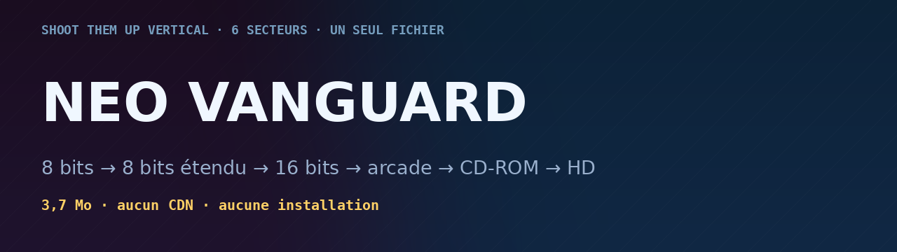

# NEO VANGUARD — shoot them up vertical à moteur graphique évolutif

**▶ [Jouer en ligne](https://jacquesbv.github.io/Neo-vanguard/)** · un seul fichier HTML (3,7 Mo), aucun CDN,
clavier / souris / doigt · fiche des codes triches : [PDF](neo-vanguard-codes-triches.pdf)


Jeu complet dans **un seul fichier `index.html`** — aucun asset externe, aucune requête réseau :
**tous les sprites, décors, palettes, musiques et bruitages sont générés par le code** au démarrage
(pixel-art procédural, séquenceur chiptune, synthèse WebAudio). Le moteur de présentation WebGL 2
(PixiJS v8 minifié, 394 Ko) est **inliné dans le fichier** : le jeu s'ouvre hors ligne, et depuis
GitHub Pages il ne charge rien d'autre que la page elle-même.

## Moteur graphique : WebGL 2 (PixiJS v8), repli 2D automatique

Le dessin reste **procédural en canvas 2D** — c'est lui qui fabrique les sprites, les décors et les
palettes de chaque génération. Sa sortie est envoyée au GPU comme texture, et **tout le
post-traitement est exécuté dans un shader unique** (une passe, un quad) :

- **bloom HDR additif** : seuil de luminance (`ColorMatrixFilter`) puis flou gaussien multi-passes,
  composé en `add` par-dessus l'image ;
- **aberration chromatique** radiale (les bords séparent les canaux) ;
- **onde de choc** : les gros impacts déclenchent un anneau de distorsion centré sur le vaisseau ;
- **courbure cathodique** (option CRT), **scanlines** à la période exacte de l'écran, **vignette** et
  **grain** de film ;
- tous ces effets sont **masqués au terrain de jeu** (uniform `uPF`) : le HUD et les panneaux
  latéraux restent nets, les effets ne bavent jamais dessus.

**Qualité automatique.** Si l'image dépasse 24 ms, le halo descend en résolution réduite, puis en
palier de secours ; si elle reste au-dessus de 33 ms même en secours, le mode **AUTO rend la main au
canevas 2D** (message à l'écran). Le choix explicite de l'utilisateur n'est jamais contredit :
Options ▸ **Moteur de rendu** = AUTO / GPU / 2D, avec l'état du moteur affiché en direct (palier et
images par seconde du GPU). Le canvas WebGL est retiré du DOM quand on repasse en 2D, et réattaché
au retour — la bascule est instantanée, en pleine partie.

Mesures sur le secteur 4 (489×876 px, Chrome headless, **rastériseur logiciel SwiftShader** : la
partie GPU y est donc très pessimiste) :

| Chemin de rendu | Temps par image |
|---|---|
| Canevas 2D sans post-traitement (ce qui reste au CPU en mode GPU) | **2,57 ms** |
| Chemin 2D historique complet (bloom + aberration + vignette CPU) | **13,11 ms** |
| Post-traitement GPU mesuré en SwiftShader | 207 ms (remplissage logiciel : ÷4 sur les pixels ⇒ ×3,5 de vitesse ; quelques ms sur un vrai GPU) |

Autrement dit : **10,15 ms par image ont quitté le CPU**, et ce qui reste côté GPU est du remplissage
d'écran, pas du JavaScript. La régression complète (7 vaisseaux × 6 secteurs, boss, fin de campagne)
passe par les deux chemins avec **0 exception de rendu et 0 erreur JS**, et le mode 2D reste
strictement identique à la version précédente.

## Le concept : 6 secteurs, 6 générations de consoles

Le moteur de rendu, les sprites, les décors **et la bande-son** changent complètement à chaque secteur.

| Secteur | Génération | Graphismes | Décors | Audio |
|---|---|---|---|---|
| **1** | **Pocket / Home System / 8 bits** | 160×144, **4 teintes strictes** du Pocket KDM-01, gros pixels, silhouettes simplifiées, ombres portées pixel | Station en coupe vue de dessus : dalles, plaques rivetées, conduites, baies techniques, docks, grues, grilles de ventilation, bandes de danger, hublots, couloirs de descente à lèvre métallique | 124 BPM en **la mineur**, 2 canaux d'onde carrée + bruit blanc, zéro reverb |
| **2** | **8-bit étendu (Home System)** | 256×224, 16 couleurs, sprites plus détaillés (ailes, verrières, réacteurs), premières transparences | Station dense : panneaux éclairés, poutrelles de premier plan, champs d'astéroïdes | 140 BPM en **ré mineur**, triangle pour la basse, arpèges, batterie bruit, écho léger |
| **3** | **16-bit (Super 16 / Neon Drive)** | 320×240, palette large, ombrage lissé, lisérés néon, halos additifs | Espace profond : nébuleuses, mégatours éclairées, passerelles, anneaux orbitaux, hologrammes, cristaux, poutrelles floues au premier plan | 150 BPM en **fa# mineur**, basse FM, lead vibrato, nappes, arpèges 16es, delay |
| **4** | **Arcade (ARC-24)** | 320×224, **32 teintes d'arcade**, grosses sprites, couleurs saturées. Balayage CRT et dominante magenta sur toute l'image | **La salle d'arcade** : bornes à écran allumé, enseignes néon qui hésitent, monnayeurs, ciel de nuit indigo, ville debout | 158 BPM en **sol# mineur**, basse en croches, cuivres sur les temps, batterie dense — ça doit s'entendre par-dessus les autres bornes |
| **5** | **32-BIT CD (Nova CD)** | 320×240 assumés, **résolution interne réduite et tramage ordonné 4×4**, 15 bits de couleur, brouillard de portée, aucune concession au lissage | Ruines de la génération CD : monolithes striés, portails à anneaux tournants, piliers de données, planète bandée à l'ancienne | 146 BPM en **ré# mineur**, sub-basse, nappes filtrées, batterie cassée, beaucoup d'air et de réverbe |
| **6** | **HD — rendu vectoriel temps réel** | Vectoriel lissé (polygones + dégradés), bloom double passe, aberration chromatique, vignette, ombres, 2000 particules, ondes de choc | Mégastructures néon complexes, anneaux géants en rotation, cristaux lumineux, profondeur de champ (premier plan flouté) | 162 BPM en **mi mineur**, super-saw, sub-basse, nappes filtrées, **réverbe à convolution**, sidechain, stéréo |

Deux ennemis n'existent que dans les nouvelles salles : la **mine** de l'arcade (elle ne tire pas,
elle bloque, et sa mort libère une **couronne de 12 tirs**) et le **tireur embusqué** du CD, qui
s'arrête, visse et lâche un trait très rapide.

Chaque secteur apporte aussi **de vrais nouveaux sprites pour tout le monde** : vaisseaux, 11 types
d'ennemis et les 4 boss sont re-dessinés d'un cran de détail à chaque ère (des plaques et des
pièces apparaissent même à partir du secteur 2 et 3 : un même vaisseau gagne des ailerons, des
canons, des halos en montant en génération).

## Transitions cinématiques entre générations

Le passage d'un secteur à l'autre est mis en scène : le vaisseau monte en vitesse (lignes
radiales, défilement accéléré), puis **le monde de l'ancienne génération est capturé et s'effeuille
en volets alternés qui partent du centre**, tandis que la nouvelle génération s'installe en direct
(bascule CRT, onde de choc, thème et musique du nouveau moteur). Le bandeau d'ère s'affiche
par-dessus. Une touche ou un clic passe la transition.

Elle est aussi utilisée **au lancement d'une partie** : depuis le menu titre en HD, appuyer sur
« Jouer » déclenche le saut vers la Pocket — le concept du jeu se montre dès la première seconde.

## L'histoire : quatre pages de récit avant la première cartouche

Le jeu s'ouvre maintenant sur une **vraie introduction** — quatre pages illustrées, écrites par le
moteur, à la machine à écrire. Elle s'affiche au lancement d'une campagne (et se relit à tout
moment depuis **L'histoire** dans le menu) :

| Page | Titre | Texte | Signature |
|---|---|---|---|
| 1 | *2049 — TERRE, ARCHIVES MORTES* | Il y a trente ans, on a cessé de fabriquer des consoles. Ce qui restait du jeu vidéo a été entassé dans **six cartouches**, puis enfermé dans un silo de béton, sous le désert. | « On garde les cartouches. On oublie les machines. » |
| 2 | *L'EMPIRE KABRAK* | KABRAK n'a pas attaqué les villes : il a attaqué les archives. Secteur après secteur, la mémoire est **reformatée en gris**. Là où il passe, plus personne ne se souvient d'avoir joué. | « Ce qui n'est pas conservé n'a jamais existé. » |
| 3 | *PROGRAMME VANGUARD* | Dans la sixième cartouche dormait un dernier pilote. Sa coque porte les couleurs de toutes les générations : **bande rouge** pour l'escadrille, **verrière cyan** pour la vitesse. | « Une cartouche peut sauver une mémoire. » |
| 4 | *ORDRE DE MISSION* | Traverse les six générations : Pocket, huit bits, seize bits, arcade, CD-ROM, haute définition. Abats leurs amiraux. Au bout : **le CŒUR**, la salle où KABRAK réécrit l'histoire. | « Pilote, tu es la dernière copie intacte. » |

Chaque page a son illustration peinte : les six cartouches dressées dans le noir, la flotte KABRAK
— des vaisseaux longs et plats, sans grâce, avec la corruption qui monte et sa **ligne de front
dentelée** striée comme une mémoire reformatée —, le VANGUARD en plan large feux allumés, puis le
CŒUR entouré de ses anneaux avec les six secteurs en orbite. Le texte se déroule
tout seul (≈ 6 s par page) ; un appui passe immédiatement à la suite.

## La boîte de jeu : la typologie réelle de chaque machine

Avant chaque secteur — y compris le premier — **la boîte de jeu du niveau apparaît pendant quatre
secondes** : la jaquette illustrée, sa matière, la fabrication de son constructeur, son code
produit, et à côté **le support** (cartouche ou disque). Elle glisse depuis la droite avec son
sillage, un reflet la balaie, puis elle **fonce vers le joueur** et le niveau commence. Un appui
sur l'écran saute l'annonce.

Les boîtes ont été **reprises aux cotes des originales** (millimètres réels), et surtout à leur
**fabrication** : un Pocket ne s'emballe pas comme une shockbox Arcadia.

**Aucune marque réelle** : les six constructeurs du jeu sont fictifs (Kodama, Vega, Arcadia,
Nova), les cotes, elles, restent celles des emballages d'époque.

| Secteur | Boîte | Cotes réelles | Fabrication |
|---|---|---|---|
| 1 | **Kodama Pocket** (`KDM-01`) | 122 × 130 × 30 | carton souple crème, rabat supérieur, logotype **POCKET** bleu nuit dans son ovale, **Kodama** rouge, code KDM-01, sceau doré « Quality Mark », quatre teintes |
| 2 | **Kodama Home System** (`KHS-NV`) | 133 × 190 × 38 | carton rigide noir, rabat du dessus, logotype **HOME SYSTEM**, sceau doré, bande d'avertissement |
| 3 | **Kodama Super 16 PAL** (`SP16-NV`) | 186 × 126 × 31 | carton-paysage à **fourreau** : le tiroir sort à droite et montre l'étiquette de la cartouche, liseré des quatre couleurs, sceau doré |
| 4 | **Arcadia shockbox** (`ARC-260`) | 190 × 135 × 35 | coffret souple noir façon VHS, cadre doré, œillet, fenêtre à cartouche, **ARCADIA** or |
| 5 | **Nova CD PAL** (`NVCD-00001`) | 142 × 125 × 11 | boîtier CD translucide (charnière noire, reflet du plastique), bandeau **Nova CD**, bandeau gris PAL, fourreau |
| 6 | boîtier HD | 136 × 172 × 15 | boîtier brossé, bandeau bleu HD |

L'emballage **Vega Neon Drive** (`ND-NV-01`, étui à clapet 181 × 133 × 32, trame en croisillons,
plaque dorée, étiquette **16-BIT** rouge, sceau Vega) fait partie de la planche : c'est la machine
rivale du secteur 3, conservée comme septième emballage du catalogue.

**Une seule boîte par secteur** : l'annonce montre l'emballage de la machine qui porte le niveau,
du premier au dernier instant — plus de second carton qui prend sa place à mi-parcours.

Les **supports** ont eux aussi leurs cotes : cartouche Pocket 57 × 65, cartouche Home System
121 × 129, Super 16 132 × 88, Neon Drive 110 × 78, Arcadia 96 × 132 — chacune avec sa coque moulée,
ses rainures et son étiquette. Un tiroir ouvert ne montre jamais deux fois la même cartouche.

Chaque jaquette est **peinte par le moteur, dans la palette de sa machine** : l'art du jeu, puis
les signes du constructeur (sceau Kodama doré, disque Vega, plaque Arcadia, marque Nova, code
produit, code-barres, mentions). Les gros logotypes se **rétrécissent tout seuls** pour ne jamais
sortir de la boîte. La planche complète est dans **`boites-3d.png`**.

## Le pack d'images : explosions et butin

Le moteur dessine tout lui-même — c'est ce qui lui permet de tenir dans un fichier unique et de
changer de palette à chaque génération. Le pack graphique ne le remplace donc pas : il **prend la
main là où une image fait mieux que le dessin**, et **nulle part ailleurs**. Si une image manque,
si la déclinaison de la machine n'existe pas, ou si `ART.on` passe à `false`, le jeu est
**exactement celui d'avant** : aucune régression n'est possible.

Cinq images composent ce premier pack, livrées détourées (fond magenta) puis **quantifiées dans la
palette de la machine** par `tools/art-build.py` :

| Image | Ce qu'elle fait | arcade | CD-ROM | HD |
|---|---|---|---|---|
| `boom` | l'explosion des grosses pièces (boss, barils, mort du joueur) | 208 px | 224 px | 240 px |
| `boom-sm` | l'explosion des petites — **le cas le plus fréquent d'une partie** | 144 px | 160 px | 160 px |
| `spark` | l'éclat d'impact qui double les grosses explosions | 120 px | 128 px | 136 px |
| `shard` | les éclats de coque projetés par les très grosses | 120 px | 128 px | 144 px |
| `case` | le **coffre** : module de butin à abattre, et écrin des bonus au sol | 96 px | 104 px | 112 px |
| `tour` | la **mégatour** du décor — le plus grand objet de l'écran | 218×448 | 249×512 | 311×640 |
| `paroi` | la **paroi de service** du décor (pipes, grilles, bandes de danger) | 124×192 | 139×216 | 170×264 |
| `ship` | **le vaisseau du joueur** : celui que tu regardes pendant toute la partie | 152 px | 168 px | 184 px |
| `drone` `stinger` `runner` | les **ennemis de base** du secteur 4 | 144-152 px | 160-168 px | 176-184 px |
| `turret` `mine` | la **tourelle** fixe et la **mine** à pointes | 112-176 px | 128-192 px | 144-208 px |
| `fond` | **la toile de fond** : nébuleuse et étoiles, opaque | 573×320 | 573×320 | 616×344 |
| `shielder` `splitter` `sniper` `carrier` `elite` | la **suite du bestiaire** : éclaireur lourd, éclateur organique, tireur d'élite, porte-vaisseaux et **l'élite** — le mini-boss qui revient dans tous les secteurs | 112-208 px | 128-232 px | 144-256 px |

**Une déclinaison par machine, pas par style.** Le jeu compte deux indices différents : le
**secteur** (une machine par secteur) et l'**ère** (le style de rendu — la 2 sert aussi bien au 16
bits qu'à l'arcade). Le pack suit le **secteur** : arcade pour le secteur 4, palette 64 couleurs
pour le 5, couleurs pleines pour le 6. Les secteurs à pixels (Pocket, Home System, Super 16, Neon Drive)
gardent leur **dessin d'origine** — une image riche réduite à quatre tons verts devient une tache
floue, la quantification d'une illustration n'est pas une conversion de pixel-art.

Ce que ça donne en jeu : sur une **grosse explosion**, le dessin du moteur posait quatre pâles
taches colorées ; le pack pose un vrai feu, cerclé de noir, dont les particules du moteur
deviennent la poussière. Le **coffre de butin** — un module cyan illisible — devient un coffre
ouvert, doré, qui se lit d'un coup d'œil comme « abats-moi et prends ce qu'il y a dedans ». Les
écrins de bonus, eux, **prennent la couleur du bonus** : la teinte est retrouvée depuis la teinte
d'origine du bonus, donc le code de couleurs d'origine est conservé. Les images de bonus sont
aussi un peu plus lisibles qu'avant à petite taille.

**Les héros aussi.** Le vaisseau du joueur et **les dix ennemis du jeu** — chasseur, piqueur,
éclaireur, tourelle, mine, éclaireur lourd, éclateur, tireur d'élite, porte-vaisseaux et l'**élite**
qui sert de mini-boss à tous les secteurs — sont peints par le modèle puis branchés sur le même
point de dessin que les sprites du moteur. Trois précautions : chaque image est **peinte dans le bon sens** (nez vers le
haut, tuyères en bas, comme les gabarits du moteur) ; elle reçoit un **léger voile de la couleur de
sa machine**, si bien que la lecture par secteur est conservée — le chasseur reste violet, le piqueur
orange, la mine verte ; et les silhouettes ont été choisies **volontairement très différentes** les
unes des autres. Dans un shoot them up, on doit reconnaître une mine d'un chasseur d'un seul regard :
c'est la seule chose qu'aucun gain graphique ne peut se permettre de casser. Les images passent enfin
par une **relève de saturation** avant quantification, sans quoi une illustration posée sur un fond
noir paraît terne à côté des palettes d'arcade.

**Le décor aussi a bougé.** Les deux plus gros blocs du décor — la **mégatour** et la **paroi de
service** — sont désormais des images : la ville de nuit du secteur 4 passe de dalles bleues plates à
un vrai skyline éclairé, tours hautes comme des immeubles avec leurs fenêtres allumées, leurs
enseignes et leurs parois techniques. Le moteur cuit chaque bloc une fois puis le recopie : les
images profitent du **même cache**, elles ne coûtent donc rien à l'image suivante. Une tour sur deux
est **retournée**, et la paroi est **recadrée** au lieu d'être écrasée — c'est le seul bloc dont les
proportions ne changent pas. Détail qui a son importance : le cache du décor ne se vidait qu'au
changement **d'ère**, or deux secteurs voisins partagent la même ère (le 3 et le 4 sont tous deux en
16 bits) ; le pack dépendant du **secteur**, le cache est maintenant vidé à chaque début de niveau —
sinon le secteur 4 aurait réutilisé les tours dessinées pour le secteur 3.

**Le fond aussi.** Une nébuleuse traversée d'étoiles remplace le dégradé et ses trois taches
flottantes. Elle est traitée à part, et pour trois raisons : elle est **opaque** (rien à détourer),
elle passe par une **courbe de tons** qui écrase les nuages tout en gardant les étoiles, et elle
reste à **demi-opacité** — un fond doit rester un fond. Elle est toujours un peu plus grande que la
fenêtre et dérive lentement : elle la couvre quoi qu'il arrive, donc sans bord ni couture à raccorder.
Elle est posée juste avant la carcasse de la machine, si bien que le boîtier de la console reste net.

Ce que ça ne fait **pas** : le **boss**, qui reste qui restent
procéduraux — le boss du secteur 4 est un objet unique, très large, et son remplacement coûterait
plus de poids qu'il n'apporterait. Petite explosion d'un ennemi de base, le gain est **modeste** — les particules du
moteur couvrent déjà la zone. Un pack complet (vaisseaux, ennemis, décors, fonds) demanderait une
centaine d'images et **plusieurs mégaoctets** : c'est faisable par étapes, machine par machine,
mais le pack va jusqu'où le budget le permet — **dix-neuf images**, 1,87 Mo de PNG et **2,44 Mo
inlinés** (juste sous la barre des 2,5 Mo qu'on s'était fixée), sur un fichier qui passe de 1,1 Mo
à **3,7 Mo**.

Les planches sont dans **`planche-pack.png`** (les dix-neuf images et leurs trois déclinaisons),
**`comparatif-bestiaire.png`** (les dix ennemis, avant/après),
**`comparatif-fond.png`** (la toile de fond, avant/après),
**`comparatif-heros.png`** (le vaisseau et les ennemis, avant/après),
**`comparatif-explosion.png`** (une grosse explosion, image par image, avant/après),
**`comparatif-decor.png`** (la mégatour et la paroi, avant/après) et **`captures-secteur-4.png`**
(le secteur 4 en jeu, avant/après).

## Après le boss : la récolte

Battre un boss dispersait une pluie de pièces que le passage au secteur suivant **avalait** avant
qu'on puisse les ramasser. La mort du boss ouvre désormais une **fenêtre de récolte de 6,4
secondes** : un bandeau doré affiche le compte — « RÉCOLTE · 41 PIÈCES · TOUT EST AIMANTÉ · RIEN NE
SERA PERDU » —, les tirs ennemis sont **vidés** et crédités, les survivants transformés en bonus,
le vaisseau devient **intouchable**, et au bout d'1,6 s **tout est aimanté** vers lui. Les pièces
sorties du cadre sont **ramenées par une bague** sur les bords, et à l'expiration, ce qui reste est
**encaissé d'office** avec un compteur « + N × RAMASSÉ » : zéro pièce perdue, même dans un coin
d'écran. En coopération, l'invité voit le même bandeau et la même pluie.

## Contenu

- **6 secteurs + 4 boss multi-phases** (Goliath-Prime, Warden-7, Hydra-Nexus, Omega-Vector) :
  les amiraux reviennent en **MK-2** dans les secteurs 5 et 6, plus rapides et plus épais.
  La campagne se termine par l'écran **Système neutralisé**.
- **Décor destructible** : caisses de fret, barils explosifs (réaction en chaîne qui endommage les
  ennemis proches) et modules de ravitaillement à butin garanti dérivent dans le couloir. Ils se
  détruisent au tir, rapportent score et crédits, et changent de sprite selon l'ère.
- **9 types d'ennemis** : drones, stingers, coureurs, tourelles, boucliers rotatifs, diviseurs,
  essaims, porteurs (qui libèrent des nuées), élites + un mini-boss à mi-secteur.
- **7 chasseurs d'arcade** dessinés à l'école UN Squadron / Axelay / Alpha Mission II :
  nez effilé, verrière en goutte, voilures delta, **pods d'arme en bout d'aile**, canards,
  dérives jumelles et tuyères cerclées. Chacun est **re-rastérisé pour les 6 générations**
  (voir `apercu-vaisseaux.png`) :

  | Vaisseau | Rôle | Prix | Signature |
  |---|---|---|---|
  | **VANGUARD MK-I** | polyvalent | — | le vaisseau du joueur (voir la section dédiée) |
  | **FALCON-A « MARTEAU »** | assaut lourd | 1 250 CR | nacelles jumelles, +1 bouclier, collisions −25 % |
  | **FALCON-B « LAME »** | interception | 1 050 CR | ailes en mouette, cadence +18 %, esquive 8 % |
  | **VIPÈRE** | intercepteur | 450 CR | aiguille rapide, esquive 15 % |
  | **TITAN** | forteresse | 950 CR | blindé, collisions ÷2 |
  | **SPECTRE** | furtif | 1 700 CR | aile volante, tirs perforants |
  | **SINGULARIS** | prototype | 3 200 CR | amiral : +1 drone, bouclier régénérant |
- **5 armes**, **10 équipements améliorables**, bombes, 6 livrées
  (elles changent aussi **toute la palette Pocket**), 4 traînées, 5 auras.
- **Options** : volumes, secousses, difficulté (Cadet/Pilote/As), annonces vocales, visée souris,
  tir automatique, FPS, lissage HD, scanlines CRT, aperçu graphique, plein écran, reset.
- **Qualité adaptative** : si la machine faiblit, le jeu réduit les particules, les halos, le bloom,
  puis la résolution interne — sans jamais casser le gameplay. Écran FPS activable dans les options.
- **Sauvegarde automatique** (localStorage), avec migration depuis les versions précédentes.

## Secteur 6 : rendu « animé japonais »

Le dernier secteur ne se contente pas d'être de la HD : il emprunte **le langage visuel de
l'animation japonaise**, appliqué à un jeu entièrement procédural. (Les repères de cette section
citent les anciens numéros de secteur : le rendu vectoriel anime est passé du secteur 4 au
**secteur 6** quand la campagne est montée à six générations.)

- **Cel-shading à 3 valeurs** : l'éclairement de chaque pixel est mesuré, puis quantifié en
  bandes franches — ombre, valeur moyenne, lumière. Fini les dégradés 3D.
- **Trait d'encre** : les contours ne sont plus une ombre plus sombre mais un véritable trait
  bleu-noir, comme un encrage de dessin animé.
- **Color script** : les ombres sont refroidies (teinte −16°, saturation +16 %) et les lumières
  réchauffées (+12°) — la recette de base de toute peinture animée.
- **Ciel peint** (toile de 480×1900 cuite une fois) : soleil pâle, **fantômes d'objectif**,
  planète géante avec anneaux, bandes nuageuses, terminateur et limbe lumineux, mégapole
  nocturne à trois plans, bancs de nuages interstellaires — défilé en parallaxe lente.
- **Pétales et braises** portés par le souffle du vol, tournoyant au premier plan.
- **Lignes de vitesse et cadre d'impact** : à chaque accélération ou gros choc, des lignes de
  vitesse radiales et un anneau d'impact net (sans dégradé) envahissent l'écran — le vocabulaire
  classique du « punch » animé.
- **Caméra vivante** : la caméra bascule légèrement sur les gros impacts.

Voir `comparaison-anime.png` : à gauche l'ancien rendu HD, au centre le nouveau, à droite un gros
plan de boss.

## Le vaisseau du joueur : VANGUARD MK-I

Le vaisseau du joueur n'est **pas dessiné à la main** : sa géométrie est **vectorisée directement
depuis la planche fournie** (`uploads/IMG_20261015_074024.jpg`). La planche est mesurée au pixel,
puis convertie en polygones par un vectoriseur (suivi de contour par arêtes orientées,
simplification de Douglas-Peucker, échelle métrique exacte). Résultat : 122 formes fermées,
2 260 sommets, **IoU 0,991** avec la silhouette de la planche.

Les masses de la planche deviennent des **matières** du moteur :

| Matière | Ce qu'elle porte dans la planche |
|---|---|
| `HULL` | la coque claire (l'ensemble de la silhouette) |
| `WING` | les volumes en demi-teinte |
| `DARK` | les panneaux sombres |
| `INK` | les nervures et l'encrage (trait quasi noir dans toutes les ères) |
| `MARK` | le marquage d'escadrille rouge (bande + chevron, reste rouge quelle que soit la livrée) |
| `GLASS` | les panneaux cyan de la verrière (cyan fixe) |

Détails relevés sur la planche : nez long et effilé, bande rouge à chevron sur l'épine,
**cockpit losangé** (veau rouge entre deux joues cyan), flancs nervurés, **moyeu circulaire central**,
ailes basses finissant en mâts d'antenne à disques, deux nacelles latérales et une queue centrale.
Les **trois tuyères** (queue + les deux nacelles) sont elles aussi relevées sur la planche
(`EXH.falcon`), tout comme la position de la verrière (`CKPT.falcon`).

La géométrie est régénérée par script, jamais retouchée à la main : le bloc `falcon:` de
`src/game.js` est la sortie brute du vectoriseur.

## Livrées : la coque change avec la génération

La livrée d'usine **ESCADRILLE** est la livrée par défaut : coque **gris-blanc**, **bande rouge**
d'insigne et **verrière cyan**, relevées sur la planche de référence. Elle ne s'applique qu'à partir
du **secteur 2** — au secteur 1, le vaisseau est peint avec les **4 tons Pocket**, donc vert, comme
tout l'écran (c'est l'ère qui l'impose, pas la livrée). Passé la Pocket, plus aucune trace du vert :
les obus, les réacteurs, le halo de verrière et le bouclier prennent eux aussi le **cyan** de la
planche, tandis que les ennemis gardent la palette de leur génération.

Les 5 autres livrées du magasin (FORÊT KODAMA, POCKET, AMBRE CRT, AZUR, PLASMA, QUANTUM) fonctionnent
comme avant : elles teintent la coque **et** les accents du joueur, dans toutes les ères, et leur
rampe de 4 tons définit la palette complète du secteur Pocket. Une sauvegarde antérieure qui
portait encore le vert par défaut bascule toute seule sur ESCADRILLE (une seule fois, et seulement
si la livrée n'avait pas été changée à la main).

## Refonte artistique : boss, bonus, décors

Tout le jeu est redessiné par la même chaîne : une silhouette (polygones normalisés) est
**rasterisée** à la définition de la génération, ombrée, puis **tramée** — c'est ce tramage ordonné
qui donne le grain des machines 8 et 16 bits. Trois couches ont été reprises de fond en comble.

- **Le moteur d'ombrage.** L'éclairement est calculé en continu (contour, épaisseur du volume,
  lumière du haut, ombre portée du bas), puis quantifié avec **tramage uniquement dans les zones de
  transition** : aplats francs, dégradés en damier sur les volumes. En Pocket, les demi-teintes
  sont écrasées pour ne garder qu'un liseré tramé — un damier étalé partout transformerait le sprite
  en bouillie. Une passe de **greebles** ajoute, à l'échelle du pixel d'art, lignes de panneaux,
  rivets, grilles de ventilation, bandes de danger et hublots allumés, là où le dessinateur les a
  demandés.
- **Les quatre boss.** Ils sont désormais bâtis comme des maquettes : 45 à 80 pièces chacun (coque,
  pont, proue de danger, sponsons d'armes, baie de lancement à hublots, cheminées, grilles
  d'admission, nervures, réacteurs, quincaillerie, marquage d'escadrille). Le boss ne bouge plus
  seul : **GOLIATH-PRIME** a deux tourelles qui suivent le joueur et reculent au tir, **WARDEN-7**
  balance deux bras articulés à masse et une tourelle de proue, **HYDRA-NEXUS** traîne trois cous à
  maillons ondulants et ouvre son iris sur le noyau quand les têtes tombent, **OMEGA-VECTOR** fait
  tourner trois couronnes de barres blindées et quatre pods. S'y ajoutent fumée de coque qui cède,
  étincelles de phase et flashes d'impact. La définition d'art des boss est passée de 85–187 px à
  **136–425 px** selon la génération.
- **Les écrins de bonus.** Fini le carré plat : collerette métallique, coque, verrière, cœur
  lumineux, quatre boulons, grilles latérales, bande de danger — chaque type a sa teinte (puissance
  or, bouclier cyan, coque verte, crédits jaune, bombe rose). Ils **tournent sur eux-mêmes**, le
  glyphe disparaît quand l'écrin présente son dos, ils projettent une **ombre au sol**, scintillent
  pour se faire repérer et laissent une **traînée fantôme** quand l'aimant les aspire.
- **Les niveaux.** La plaque de métal qui sert de brique à tout le décor est passée de 3 à **5 tons
  avec chanfreins tramés** ; le décor est **deux fois plus dense** (11 structures de sol au lieu de
  6, cadences de spawn presque doublées) ; les fonds 8/16 bits reçoivent un **damier de deux teintes
  voisines** et un clin d'œil de bandes horizontales façon défilement par bandes ; une **plateforme à tapis roulant**
  animée ponctue le sol.
- **Le Pocket.** Détails à l'échelle du Pocket : les dalles de la station passent à 64 unités
  (16 px d'art, soit deux tuiles) et reçoivent plaques rivetées, grilles, biseaux et tirants d'un
  pixel d'art, comme un plan de station en 4 teintes.

## Pack graphique : l'image, la lumière, le vaisseau

Trois chantiers, mesurés à l'image moteur (captures 1:1 dans les aperçus).

- **Le vaisseau du joueur perd encore 26 %** (98 → 72 px, soit 8,4 % de la hauteur
  d'écran ; deux passes au total : 136 → 98 → 72). La zone de tir gagnée revient au
  joueur : hitbox ramenée de 8 à 6 px, anneau de bouclier de 46 à 34, escorte de
  drones resserrée. Aucun autre changement de gameplay : c'est la même puissance de
  feu dans un chasseur plus nerveux à lire.
- **Étalonnage par génération.** Chaque ère a maintenant sa courbe, appliquée dans le
  shader GPU : saturation, contraste, gamma, ombres refroidies et blancs réchauffés.
  La Pocket reste brute, le 16 bits gagne en piqué, la HD prend une couleur de
  cinéma d'animation. Le repli 2D reçoit une approximation par composition.
- **Éclairage dynamique.** Chaque particule lumineuse (explosion, impact, réacteur,
  tir de boss) dépose une source dans un anneau de 40 entrées ; ces sources sont
  cuites dans un calque au quart de la résolution puis **ajoutées** à l'image.
  Une explosion éclaire réellement le sol et la coque autour d'elle — et le halo
  « bokeh » plat a été remplacé par une décroissance douce.
- **Rayons de lumière et profondeur de champ.** Cinq nappes de lumière traversent l'ère HD.
  Elles partent du **soleil peint dans le ciel** — donc de sa position réelle à l'écran, qui
  défile — et s'éteignent quand il sort du champ : plantées au centre haut, elles lisaient
  comme un projecteur de studio. Les calques lointains sont agrandis en lissé, ce qui détache
  l'action du décor au lieu de la noyer.
- **Vie de la coque.** Un reflet solaire balaie le fuselage (masqué par la silhouette
  exacte du sprite, donc il ne déborde jamais), les feux de navigation clignotent
  rouge à bâbord et vert à tribord, et sous 34 % de coque le vaisseau fume et crache
  des étincelles.
- **Définition HD ×1,28** : les buffers de l'ère 4 passent de 1,25 à **1,6 px par unité
  logique** (768×1376), avec trois paliers automatiques (1,60 / 1,25 / 0,96) selon la
  cadence mesurée — le trait vectoriel devient net sans risquer la fluidité.
- **Sprites 8/16 bits.** Un **filtre médian des tons** (2 passes en Pocket, 1 en 16
  bits, appliqué aussi aux boss) remplace le moucheté par des bandes franches : c'est
  la différence entre un sprite qui se lit et un sprite bruité.
- **Moteur d'ombrage revu** pour tout ce qui est cuit : liséré clair, biseau à 5 tons,
  tramage ordonné entre deux tons voisins, greebles choisis un par un au lieu d'être
  tirés au hasard. Les boss, les écrins et les décors en profitent automatiquement.

### Dernière passe : particules GPU, poses cuites, secteur 4 reconquis

- **Particules sur le GPU.** Les débris lumineux ne sont plus dessinés au canevas : ils
  deviennent des **sprites PixiJS en additif**, servis par un pool de 1 800 éléments.
  Le plafond passe de 1 200 à **4 000 particules** (70 / 420 / 1 500 / 3 600 selon la
  génération), et le coût par particule s'écroule : mesuré dans le même environnement,
  l'ère 4 rend en **31 ms** avec les particules GPU contre **38 ms** au canevas. Repli
  automatique sur le canevas si le GPU n'est pas là, avec réduction du plafond.
- **Poses cuites.** Chaque sprite est cuit en **quatre poses** (ailes qui battent,
  mâchoires qui s'ouvrent, tourelles qui reculent au tir) et l'animation se joue en
  échangeant la texture, sans une seule transformation par image. Contrôle chiffré du
  nombre de pixels qui changent entre la pose 0 et la pose 1 : porte-vaisseaux 204,
  élite 262, bouclier 80, drone 61, écrin 18, caisse 34.
- **Étalonnage par génération + flou de mouvement.** La courbe de chaque ère est cuite
  en **table de couleurs** appliquée par le shader (saturation, contraste, gamma, ombres
  refroidies, blancs réchauffés) ; en HD s'ajoute un flou de mouvement proportionnel à la
  vitesse de défilement. Le flou souffrait d'une erreur d'unité (l'offset d'échantillonnage
  était multiplié par la taille de la texture au lieu d'être divisé) : les quatre
  échantillons tombaient à des centaines d'écrans de distance et se bloquaient sur les
  bords, peignant un faux projecteur en éventail par-dessus le secteur. Corrigé.
- **Secteur 4 reconquis.** Le mobilier 8 et 16 bits (plateformes, baies, docks, anneaux,
  cristaux) est **retiré de l'ère HD** — c'était le patchwork d'hélices et de flaques
  bleues — et remplacé par des gabarits propres à la génération : **coque de
  vaisseau-capitale** et **échafaudage orbital**. Le bloom de l'ère HD redescend de
  0,42 à 0,26 : à 0,42 le secteur virait au pastel.
- **Flash d'impact par génération.** Un ennemi ou un boss touché ne clignote plus en
  blanc universel : il clignote dans **sa** palette. La Pocket n'a que quatre teintes,
  dont aucun blanc — le sprite touché passe donc au **ton le plus clair de la livrée
  active** (vert clair en ESCADRILLE, gris clair en POCKET, ambre en CRT, bleu en AZUR…),
  soit exactement ce qu'un écran Pocket peut produire. L'ère 8 bits+ flashe en blanc glacé
  de sa palette, le 16 bits en blanc franc, la HD en blanc pur (que le bloom transforme
  en éclat). Corrigé au passage : la HD **n'affichait aucun flash** sur les ennemis (le
  chemin vectoriel n'implementait pas l'option), et les cœurs d'obus, de laser, de
  rayon et les flashs plein écran étaient peints en blanc codé en dur partout.
- **Les bonus du secteur 1 sont des pièces.** La caisse à « ? » disparaît : en Pocket,
  les écrans montraient une **pièce** de dix pixels d'art — octogone à coins coupés, contour
  noir, cerclage au ton moyen, face claire et une marque par bonus (plein carré pour la
  puissance, anneau pour le bouclier, croix pour la coque, jeton barré pour les crédits,
  éclat pour la bombe). Elle tourne sur elle-même en s'amincissant jusqu'à la tranche, ce
  qu'une palette de quatre teintes suffit à lire. Au passage, le caractère `$` manquait dans
  la police 5×5 : l'écrin des ères suivantes affichait donc lui aussi un « ? » — il est
  désormais dessiné (`27272`).
- **Coins de l'écran de triche.** Les carrés à « ? » sont remplacés par quatre **coins**
  dessinés en dégradés CSS : plus aucune dépendance à une police exotique, les carrés
  manquants ne peuvent plus revenir.
- **Interface tactile.** La barre de commandes s'affiche vraiment en jeu (elle restait
  masquée : la classe `playing` était effacée au changement de génération) et les
  pastilles **ARME** et **BOMBE** se mettent à jour (arme courante, jeu d'armes, bombes).
- **Pilotage au doigt fiabilisé.** Trois corrections en une :
  1. les écouteurs d'entrée sont posés sur la **fenêtre, en phase de capture** — peu importe
     l'élément survolé (le canvas est masqué en WebGL), le geste est vu ; un seul chemin
     d'entrée (Pointer Events) remplace le mélange souris/tactile précédent ;
  2. `touch-action:none` est verrouillé sur le conteneur de jeu : plus aucun geste du
     navigateur (défilement, zoom, tirer-pour-recharger) ne peut voler le pilotage —
     c'est la cause la plus fréquente d'un vaisseau qui « ne bouge pas » ;
  3. le vaisseau se place **au-dessus** du doigt (`TOUCH_DY`) : sous le pouce, on ne le
     voyait pas manœuvrer.
- **Bombe au double tap.** L'aide la promettait depuis le premier jour, le code ne
  l'implémentait pas : désormais **double tap** (fenêtre 400 ms), **deux doigts** ou
  **bouton BOMBE** déclenchent la bombe. Mesuré au banc de test : glissement 213 px,
  double tap ✅, deux doigts ✅, bouton ✅.

## Tutoriel tactile (téléphone)

> Depuis cette passe, **le doigt commande en relatif** : poser le doigt n'attire plus le vaisseau.
> Le doigt pousse le vaisseau — il se déplace de ce que le doigt se déplace, à l'échelle du jeu.
> Un appui immobile ne déplace donc plus rien. C'est ce qui a été signalé et corrigé.

Le jeu détecte l'écran tactile et affiche une barre de commandes en bas de l'écran.

| Geste | Action |
|---|---|
| Glisser le doigt | Le vaisseau est **attiré** vers le doigt — et se place **au-dessus** de lui, pour ne pas disparaître sous le pouce |
| Doigt posé | Tir automatique pendant tout le contact |
| **Deux doigts** n'importe où | **Bombe** (écran nettoyé autour de toi) |
| **Double tap** rapide | **Bombe** aussi — le geste le plus rapide quand la main est déjà occupée |
| Bouton **Bombe · n** (en bas à gauche) | Bombe également — le compteur affiché se met à jour |
| Bouton **Arme · NOM (n)** (en bas à droite) | **Change de jeu de tir** et fait le tour des armes possédées |
| Bouton **◀** à côté | Jeu de tir précédent |

Les jeux de tir s'enchaînent dans l'ordre : **PULSE → SPREAD → LASER → PLASMA → RAILGUN**,
en ne montrant que les armes achetées en boutique (les deux premières sont acquises
d'office). Le numéro entre parenthèses indique la position dans le cycle. Garde le doigt
**sous** le vaisseau plutôt que dessus : il ne masquera pas l'action.

## Les boucles : ce qui donne envie de relancer

Trois boucles s'empilent : le plaisir immédiat du style arcade, la raison de
revenir demain, et la rivalité avec soi-même. Tout est local (aucun serveur) et
tout est traduit dans les cinq langues.

### 1. Arcade — la boucle immédiate

* **Chaîne (combo)** : chaque ennemi enchaîné ajoute **+0,05 ×** au multiplicateur,
  plafonné à **×4** (60 ennemis). Le compteur s'affiche en bas à gauche avec sa
  barre de temps qui se vide : la retombée est visible, donc la relance est
  volontaire. Rater un tir qui laisse un ennemi s'échapper casse la chaîne.
* **Frôlements (grazing)** : passer à moins de 20 px d'un tir ennemi sans le
  toucher rapporte des points et **charge la jauge de SURCHARGE**. À 90
  frôlements, la jauge explose : tous les tirs ennemis sont effacés, les dégâts
  pleuvent sur toute la vague et le vaisseau devient invulnérable 2 s. C'est la
  récompense du risque — celui qui joue trop prudemment ne la verra jamais.
* **Médailles de secteur** : à la fin de chaque secteur, **BRONZE · ARGENT ·
  OR · PLATINE** selon quatre critères lisibles (ennemis détruits, aucune perte,
  chaîne ×2,50, 120 frôlements) jugés **sur le secteur**, pas sur la partie. Le
  « il t'en manquait un » transforme la fin de niveau en invitation à rejouer.
* **Continus** : à l'écran de fin, **CONTINUER pour 3 crédits** (9 secondes pour
  se décider) reprend la mission au même endroit, avec vies et bouclier rendus.
  Le rang et le fantôme en tiennent compte — c'est du service, pas de la triche.

### 2. Progression — la raison de revenir

* **Défi du jour** : la date du jour donne une **graine** ; tout le monde joue
  donc la même mission, avec les mêmes trois contraintes tirées parmi : ennemis
  +50 % de coque, tirs ennemis +25 %, bombes interdites, fenêtre de combo
  réduite à 1 s, frôlements ×2, boucliers coupés. **Une seule tentative
  compte** par jour, mais on peut s'entraîner autant qu'on veut ensuite.
  Quitter le jeu coupe la graine : l'entraînement libre redevient aléatoire.
* **Série de jours** : revenir chaque jour allonge la série (puce `SÉRIE n J`
  sur l'écran titre). Un jour manqué la remet à 1 — c'est le seul mécanisme
  « FOMO », et il ne coûte rien.
* **Déblocages par exploits** : six exploits ouvrent des objets de la boutique
  sans dépenser un crédit — médaille d'or au secteur 1 (une aura), chaîne ×50
  (SPECTRE), 500 frôlements (LASER), série de 3 jours (traînée ION), une
  médaille dans les 6 secteurs (livrée QUANTUM), rang S (SINGULARIS). Chaque
  exploit paie aussi **500 crédits**.

### 3. Compétition — la rivalité avec soi-même

* **Rang S / A / B / C / D** calculé sur le score, la survie, les continus, la
  chaîne et les frôlements, rapporté au niveau atteint. Affiché en gros sur les
  écrans de fin.
* **Fantôme du record** : ton meilleur run rejoue **en translucide** à côté de
  toi, image par image, à la position exacte que tu occupais. Il ne collisionne
  pas, il ne pousse pas — il montre juste la trajectoire à battre. (Désactivable
  dans les Options.)
* **L'écart exact** : « **IL TE MANQUAIT 1 275 POINTS** » s'affiche sur l'écran
  de fin quand tu échoues près du record. C'est la phrase qui fait relancer.
* **Classement local** : les **10 meilleures parties** avec leur rang et leur
  mode (campagne, 2 joueurs, défi du jour), dans un panneau **RECORDS** qui
  rassemble aussi les médailles par secteur, la série et les exploits.

Le classement en ligne et la coop par code d'invitation réutiliseront exactement
le même tuyau : le code d'une partie (graine + contraintes) est déjà une donnée
partageable.

## Coop en ligne : deux téléphones, un code à cinq caractères

Pas de compte, pas d'installation, pas de serveur à nous : les deux joueurs se
retrouvent sur un **relais MQTT public** (`broker.emqx.io`, `broker.hivemq.com`,
`test.mosquitto.org`), joints par un **code de session à cinq caractères** — sans
la lettre I, sans le O, sans 0 ni 1, parce qu'ils se confondent au téléphone.

* **Créer une partie** affiche le code en grand ; le second joueur tape ce code
  dans **Rejoindre** et les deux écrans passent au vert en une ou deux secondes.
* **L'hôte fait autorité** : il simule ennemis, tirs ennemis, bonus, boss et le
  **score d'équipage**. L'invité envoie son pilotage 20 fois par seconde et voit
  **le même monde** — mêmes ennemis, même boss, même barre de vie, même score —
  avec environ 100 ms de retard sur les tirs ennemis.
* **Chacun garde son vaisseau** : armes, livrée, drones et réglages restent
  propres à l'appareil. L'hôte voit arriver le vaisseau de son coéquipier à
  l'écran, exactement comme dans le jeu à deux sur une seule borne.
* **Ce qui circule** : un instantané douze fois par seconde (ennemis, boss, score,
  crédits, combo) **et la naissance des tirs** — l'invité simule ensuite leur vol
  avec la même physique, ce qui divise la bande passante par cinq :
  **environ 7 ko/s dans chaque sens**, soit ~25 Mo pour une heure de jeu.
* **Les tirs de l'invité comptent pour lui** : ils sont recréés chez l'hôte avec
  le propriétaire « joueur 2 », les points lui reviennent donc au classement de
  fin. La bombe, elle, est décidée par l'hôte.
* **Les records, médailles, séries et crédits ne sont pas enregistrés en ligne** :
  une session en coopération est une expédition, pas une performance classée.
* **Le client MQTT est écrit à la main** dans `src/net.js` (CONNECT, SUBSCRIBE,
  PUBLISH QoS 0, PINGREQ) : aucune bibliothèque à charger, le jeu reste un seul
  fichier `index.html`, toujours glissable sur GitHub Pages.
* **En cas de coupure**, les deux écrans affichent « Session interrompue » et la
  partie locale continue ; l'hôte peut relancer une session quand il veut.

Vérifié end-to-end ici, **deux navigateurs distincts, par un relais public** :
`node .ptest/coop.js` — 18 contrôles verts, 0 erreur, code de session échangé en
1,5 s, ennemis/types/score/boss identiques des deux côtés, position de l'invité
reçue par l'hôte, tirs de l'invité crédités à son nom, sortie de session propre.

## Les langues : cinq interfaces dans le même fichier

Le jeu s'écrit en français, mais **tous les textes affichés passent par un moteur de
langue** (`src/lang.js` + `src/lang-dict.js`) avant d'être tracés : HUD, briefings,
récit, jaquettes, panneaux HTML, infobulles et même les **annonces vocales** (la voix
de synthèse suit la langue choisie).

| Langue | Code | Où la choisir |
|---|---|---|
| Français | `FR` | Options → Langue, ou la puce de langue de l'écran titre |
| English | `EN` | idem |
| Español | `ES` | idem |
| Português (BR) | `PT` | idem |
| 日本語 | `JA` | idem |

* **Détection automatique** au premier lancement d'après la langue du navigateur,
  puis mémorisée dans la sauvegarde.
* **Changement instantané** : la puce `FR EN ES PT JA` de l'écran titre fait le tour
  des langues en un clic, le panneau Options l'affiche en clair.
* **La police pixel 3×5 ne connaissait que l'alphabet nu** : les accents sont
  désormais **recomposés** (glyphe de base + marque au-dessus ou au-dessous) — é è ê
  ñ ç ã õ ü sont donc corrects en Pocket comme en HD — et le japonais est tracé
  avec la police système, à la même hauteur de ligne, pour rester lisible dans les
  petits HUD.
* **Un texte sans traduction s'affiche en français** : le dictionnaire est indexé
  par le texte français lui-même, une entrée manquante ne casse donc jamais le jeu.
* Les noms de marques et les références de série (KDM-01, KHS-NV, SP16-NV,
  ARC-260, NVCD-00001, `PWR`, `KILLS`, `SC`) restent volontairement en
  anglais dans toutes les langues : c'est ce qu'on lisait sur les boîtes.

Traductions : **420 entrées** couvrant le jeu complet (dont l'écran de coopération). Pour en ajouter une langue,
il suffit d'ajouter un fichier de traduction et de relancer
`python3 tools/i18n-build.py` puis `bash tools/build.sh`.

## Écran titre et menu

Le titre n'est plus un panneau posé sur un fond : c'est une **affiche peinte par le moteur**.
Le logo est dessiné lettre à lettre en **chrome** (dégradé à six arrêts, liseré sombre, reflet qui
le traverse toutes les quatre secondes) et porte une **aberration chromatique** assumée — décalage
rouge à gauche, cyan à droite. Sous lui, la **frise des six consoles** (KDM-01 › 8-BIT › 16-BIT ›
ARCADE › CD-ROM › HD) marque la progression, avec la machine en cours surlignée, et une accroche
qui tourne. En fond, la **démonstration** : le vaisseau joue tout seul dans le secteur affiché.

La zone du titre est **mesurée à chaque redimensionnement** : le moteur publie sa hauteur en CSS
(`--titlezone`) et le dégradé comme le tracé s'y arrêtent, si bien que **le menu ne recouvre plus
jamais le logotype et la frise**. Sur les écrans courts (1 024 × 600, 800 × 600), le menu se
compacte par paliers et la bande du titre garde 291 px (contre 496 px en 1 440 × 900) : mesuré au
banc, le recouvrement est **nul sur les cinq résolutions** testées, la frise des six consoles
reste entière et le logotype s'allège (« NEO » masqué sous 250 px de bande).

Le menu est passé d'une liste verticale à une **mise en page de jeu d'arcade** : deux grands
boutons de campagne (Commencer / L'histoire), six tuiles de préparation (Boutique, Options,
Commandes, Codes, Crédits, Plein écran) avec icône, titre et sous-titre, puis une barre de
**jetons** (record, crédits, secteur max, kills, génération courante). Les panneaux d'information
ont reçu le même traitement : bord gauche coloré, ombre portée, titre en dégradé.

## Ce qui a été corrigé dans cette passe

* **Le titre n'est plus caché par le menu.** Il n'était pas recouvert : la **zone du titre se
  comprimait** sur les écrans courts, le menu montait, et le logotype comme la frise des consoles
  se retrouvaient écrasés. La bande du titre est maintenant calculée et **publiée en CSS**
  (`--titlezone`), le décor y est **découpé** (`ctx.clip()`) pour ne jamais baver sous le menu,
  quatre paliers de hauteur compactent le menu (820, 700, 580 px), et le logotype s'adapte
  (`tiny`, sous 250 px : « NEO » s'efface, la frise rétrécit, l'accroche remonte).
  **Mesure au banc : recouvrement 0 sur 1 440 × 900, 1 366 × 768, 1 920 × 1080, 1 024 × 600 et
  800 × 600.**
* **Les pièces du boss ne se perdent plus.** Le saut au secteur suivant se faisait 2,6 s après la
  mort du boss, et les 26 pièces tombaient hors de l'écran sans aimant : d'où la **fenêtre de
  récolte** décrite plus haut (8 contrôles au banc, 0 pièce abandonnée, crédits 1 835 → 4 001).
* **Les boîtes de jeu.** Elles sont repassées aux **cotes et à la fabrication des originales**
  (voir la section plus haut) : plus de boîte carrée générique, chaque machine a son carton, son
  ouverture, ses sceaux et sa jaquette — et le secteur 3 montre désormais **les deux 16 bits**.
* **Le vignettage des faces 3D.** Les faces imprimées sont posées en dalles affines : la fuite de
  la perspective se voyait sous forme de **marches grises** au tiers et aux deux tiers des faces.
  La caméra a été reculée et les dalles passées de 3 × 3 à 6 × 6 : les coutures ont disparu, et
  l'écran de boîte tient en **3,6 à 5 ms par image** même en rendu logiciel.
* **Le clavier d'ordinateur.** L'écran du prologue annonçait « ESPACE / ENTRÉE POUR
  CONTINUER » sans que la touche réponde : rien n'était câblé hors du jeu et de l'écran
  titre. Désormais **Espace, Entrée et les flèches** font défiler les pages du récit,
  **une touche passe la boîte de jeu**, **Entrée actionne le bouton principal** des menus
  et **Échap revient en arrière**. La **souris** avance (clic gauche) et recule (clic droit)
  dans le prologue. Trois pièges corrigés au passage : maintenir Espace ne déroule plus tout
  le prologue d'un coup (`e.repeat`), un bouton resté au focus après un clic **n'avale plus
  la barre d'espace** (le focus est relâché à chaque changement d'écran), et Entrée ne
  déclenche plus deux fois la même action.
* **Le prologue : plus de texte, de vraies images.** Les quatre pages passent de trois à six
  lignes, et les illustrations sont repeintes à la volée comme des plans de cinéma —
  le silo sous les dunes avec sa herse de six cartouches, le front KABRAK qui mange un
  quartier d'archives fenêtre après fenêtre, la baie d'assemblage sous son projecteur,
  la salle du CŒUR et sa carcasse noire. Le vaisseau y est tracé en **vectoriel** (le
  chemin HD du jeu) : net à grande taille, alors que la version pixelisée bavait.
  Le texte occupe la moitié droite de l'écran large, se replie tout seul sur un écran
  étroit, et la citation est écrite dans les cinq langues.
* **Deux défauts de fond trouvés en chemin** : le texte lissé basculait dans la police
  japonaise dès qu'il contenait une **minuscule** latine (le test ne connaissait que les
  capitales de la police pixel) ; et le repli des lignes supprimait les espaces quand la
  phrase commençait par un guillemet — la citation s'affichait « Ongardelescartouches ».

## Compatibilité ordinateur — ce qui a été vérifié au banc

Harnais `pc.js` (**23 contrôles**), `pc2.js` (**16 contrôles**), `titre.js`, `recolte.js`
(**8 contrôles**) et `boites3d.js` (**11 contrôles**) : zéro échec, zéro erreur JS.

* boîtes de jeu : les sept emballages ont les cotes des originales, les six fabrications sont en
  place, les sept jaquettes sont distinctes, les tiroirs s'ouvrent, **le secteur 3 ne montre
  qu'une seule boîte du début à la fin**, et chaque machine trouve bien ses cotes, sa fabrication,
  son support et sa marque (plus aucun repli silencieux sur le gabarit HD) ;
* cadrage : **six secteurs × cinq instants × trois écrans** restent dans le
  cadre ;
* titre : recouvrement nul sur cinq résolutions ;
* récolte : le boss ouvre la fenêtre, le vaisseau est intouchable, l'aimant fonctionne, rien n'est
  abandonné et les crédits sont encaissés, même en coin d'écran.

Harnais `pc.js` (**23 contrôles**) et `pc2.js` (**16 contrôles**) — le détail :

- titre : Entrée, Espace et les flèches démarrent la partie ;
- récit : Espace, Entrée, flèches, clic gauche, clic droit, Échap (passer le prologue) ;
- boîte de jeu : une seule pression de n'importe quelle touche suffit ;
- en vol : Échap et P mettent en pause, Échap reprend, X change d'arme, B largue la bombe ;
- **à deux joueurs, W reste le « haut » du joueur 2** et ne change plus l'arme du joueur 1 ;
- menus : Entrée/Espace actionnent le bouton principal, Échap revient, **les 13 commandes de
  l'écran titre répondent au clic** (dont le plein écran et le sélecteur de langue) ;
- souris : visée absolue quand l'option est active, pilotage au glissement sinon,
  **le clavier reste prioritaire** ;
- fenêtres 1024×600, 1280×720, 1366×768, 1920×1080 : arène dans l'écran, aucun débordement,
  pas de barre de défilement ; le bandeau tactile reste masqué sur ordinateur ;
- saisie d'un code de triche : les touches ne pilotent pas le vaisseau.

* **Le sens de vol de la mine.** Les onze silhouettes d'ennemis ont été repassées une par
  une : la **mine** du secteur 4 était la seule à voler **en marche arrière** — son nez en coin
  pointé vers le haut et ses deux cornes vers le bas, quand tous les autres descendent nez
  devant. Elle rejoint la liste des engins retournés au dessin (`ENEMY_FLIP`), et le contrôle
  au banc le vérifie aux trois générations (KDM-01, ARC-24, HD) : nez vers le joueur, cornes
  au-dessus, comme le drone de la même rangée.
* **Boucles d'addiction** : chaîne plafonnée ×4 avec barre de temps, frôlements
  et **SURCHARGE**, médailles de secteur, continus, défi du jour à graine
  partagée avec série de jours, déblocages par exploits, rang S/A/B/C/D,
  **fantôme du record**, écart exact au record, classement local (panneau RECORDS).
* **Nombres et symboles** : le signe `×` (multiplication, U+00D7) tombait dans la
  plage Unicode utilisée comme classe de lettres — les compteurs du type
  `CHAÎNE ×50` ou `FRÔLEMENTS ×2` n'étaient donc pas traduits. Classe corrigée
  (`×` et `÷` exclus), et les cinq langues affichent désormais ces libellés.
* **Langues** : moteur i18n complet, 5 langues, accents pixel recomposés, japonais
  tracé par la police système, sélecteur dans les Options et sur l'écran titre —
  **les boucles sont traduites aussi** (médailles, défi, rangs, déblocages).
* **Comptes du HUD** : les bombes, les crédits et le numéro de secteur sont traduits
  **sans figer les nombres** (`P1 BOMBES 4`, `CRÉDITS 1 250`, `SECTEUR 5 · 32-BIT CD`
  s'affichent correctement dans les cinq langues).

- **Pilotage au doigt : commande relative.** Poser le doigt n'attire plus le vaisseau vers ce
  point — c'était le défaut signalé. Le doigt **pousse** désormais le vaisseau : on retient sa
  position à la pose, et il se déplace **exactement de ce que le doigt se déplace**. Mesuré au
  banc : appui immobile = **0 px** de déplacement ; glissement de 72 × 48 px à l'écran = **72 × 48 px**
  pour le vaisseau. La souris garde la visée absolue.
- **La barre de vie du boss suit la génération.** Au secteur Pocket elle était bleu cyan (la
  couleur du thème HD) : elle est maintenant **peinte aux quatre verts du Pocket**, cadre épais de
  2 px d'art, **hachures** à la deuxième phase et **clignotement** à la troisième. Mesure : 0 pixel
  hors palette sur les trois phases.
- **Plus aucune couleur hors palette en Pocket.** Un filtre (`eraCol`) ramène tout accent (rose,
  cyan, rouge) au ton clair de la livrée : le mot **« BOMBE »** qui s'affichait en rose est
  désormais vert — et il reste rose dans les générations couleur, où c'est sa place.

## Aperçus

- `apercu-webgl.png` — les premiers secteurs rendus par la voie WebGL 2 (halo, aberration, vignette) ; depuis, six générations passent par cette voie.
- `couleur-vaisseau.png` — le vaisseau avant/après : vert Pocket hors secteur 1 → coque de la planche.
- `cmp-gpu-2d.png` — la même image au même instant en WebGL 2 et en canevas 2D (écart moyen 4,7/255).
- `apercu-vaisseaux.png` — les **7 chasseurs** dans les 4 générations graphiques, en grand et à la taille de jeu.
- `fidelite-vanguard.png` — la planche, la géométrie vectorisée, et le rendu du moteur dans les 4 ères.
- `apercu-vanguard.png` — le VANGUARD seul, de la Pocket à la HD animée (rendu de jeu + pixels cuits).
- `vanguard-en-jeu.png` — le VANGUARD dans les 4 secteurs, en jeu.
- `uploads/IMG_20261015_074024.jpg` — la planche de référence fournie.
- `progression-secteurs.png` — le même instant de jeu dans les 4 secteurs.
- `comparaison-anime.png` — le secteur 4 avant/après la refonte « animé ».
- `refonte-boss.png` — les 4 boss dans les 4 générations.
- `refonte-items.png` — les 5 écrins de bonus, posés puis aimantés, dans les 4 générations.
- `refonte-niveaux.png` — le rendu des niveaux après le passage artistique.
- `pack-graphique-4-eres.png` — les quatre ères après le pack graphique (étalonnage, lumière,
  rayons, reflet de coque), image moteur à l'échelle 1:1.
- `vaisseau-taille-avant-apres.png` — le vaisseau à 98 px puis à 72 px, même instant, zoom ×3.
- `refonte-boss-ombrage.png` — les quatre boss avec le nouvel ombrage.
- `refonte-vaisseau-secteurs.png` — le vaisseau secteur par secteur (coque de la planche, lumière
  propre à chaque génération).
- `secteur4-nouveau.png` — le fond du secteur 4 après reconquête : plus d'hélices ni de flaques.
- `couleur-vaisseau.png` — le vaisseau en jeu, ancienne livrée verte par défaut face à la coque de
  la planche (secteurs 2 et 4).
- `pieces-level1.png` — les bonus du secteur 1 : la pièce en situation, puis les cinq
  variantes à leur taille d'écran.
- `pack-nouveautes.png` — l'écran titre, une page du récit, et **les six boîtes de jeu** (refaite
  après le débrandage : les six constructeurs fictifs, une boîte par secteur).
- `boites-3d.png` — **la planche des sept emballages** à leurs cotes réelles : Kodama Pocket
  (KDM-01), Kodama Home System, Super 16 PAL (fourreau), Vega Neon Drive PAL (clapet),
  Arcadia shockbox, Nova CD PAL (boîtier CD), boîtier HD — avec le tiroir ouvert de la Super 16
  et de l'Arcadia.
- `briefings-secteurs.png` — les **six briefings** de secteur refaits après le débrandage : la
  machine annoncée, le lieu, l'objectif, les hostiles et l'amiral de chaque génération.
- `nouveaux-secteurs.png` — les secteurs 4 (Arcadia) et 5 (Nova CD) en jeu.
- `flash-impact-ennemis.png` et `flash-impact-boss.png` — le flash d'impact dans les 4 générations,
  sprite au repos / touché avant / touché après (sprite recadré ×2, même instant).

Depuis le débrandage, **toutes les planches de ce dépôt** affichent les marques fictives du jeu
(Kodama Pocket, Kodama Home System, Super 16, Vega Neon Drive, Arcadia, Nova CD, HD) : les légendes
d'ères des planches les plus anciennes ont été reprises une à une, à l'image, pour qu'aucune marque
réelle ne subsiste — ni dans le texte, ni dans les captures.

## Aperçu des vaisseaux

`apercu-vaisseaux.png` (à la racine) montre les 5 vaisseaux dans les 4 générations
graphiques, en grand et à la taille de jeu.

## ☠ Menu cheat

Accessible depuis le **menu titre** et la **pause**. Codes insensibles à la casse et à la ponctuation
(`Kab Rak-77` fonctionne), validation par **Entrée** ou bouton. Le code maître s'écrit **`kabrak77`**
(depuis cette version : l'ancienne graphie `kakrak77` n'ouvre plus rien).

| Code | Effet |
|---|---|
| **`kabrak77`** | **VIES INFINIES** (le HUD affiche ∞) |
| `invincible` | Coque indestructible |
| `maxpower` | Armement maximal (puissance 5) |
| `overdrive` | Vitesse ×2 et cadence +50 % |
| `matrix` | Temps ralenti à 60 % |
| `banque` | +50 000 crédits |
| `sesame` | Toute la boutique débloquée et maximisée |
| `saut` | Choix du secteur de départ (1 à 4) |

Chaque carte verrouillée affiche un indice. Une partie truquée est marquée **TRICHE ACTIVE** et
**ne bat pas les records** (score max, secteur max) ; les crédits gagnés restent acquis.

## Commandes

| Touche | Action |
|---|---|
| Flèches / ZQSD / WASD | Déplacer |
| Espace / clic (maintien) | Tirer |
| B / Maj / Ctrl (ou double tap) | Bombe intelligente |
| Échap / P | Pause · **M** : couper le son · **F** : plein écran |
| Souris / doigt | Pilotage (option « visée souris ») |

## Mettre en ligne sur GitHub Pages

```bash
git init
git add index.html README.md
git commit -m "NEO VANGUARD"
git branch -M main
git remote add origin https://github.com/<ton-compte>/neo-vanguard.git
git push -u origin main
```

Puis dans le dépôt : **Settings → Pages → Build and deployment → Source : Deploy from a branch**,
**Branch: main**, dossier **/ (root)**, *Save* → le jeu est en ligne à
`https://<ton-compte>.github.io/neo-vanguard/`.

## Pourquoi pas LÖVE / Lua ?

LÖVE est un excellent moteur — sur **desktop**. Dans un navigateur il passe par `love.js`
(une compilation WebAssembly de LÖVE) et il perd précisément ce qui fait sa force :

| Critère | LÖVE + love.js (web) | Ce jeu (Canvas 2D génératif) |
|---|---|---|
| Vitesse | pas de LuaJIT → plusieurs fois plus lent ; beaucoup de jeux ne tiennent pas 60 fps | ~60 fps en Pocket/8-bit, fluide en HD |
| Poids | runtime WASM + archive `.love` : plusieurs Mo | **un seul fichier de ~270 Ko** |
| Stabilité | mémoire limitée, plantages possibles, shaders WebGL différents du desktop | aucune dépendance, aucune compilation |
| Hébergement | GitHub Pages ne peut pas poser d'en-têtes COOP/COEP → builds multithread à éviter | un simple fichier statique |
| Rendu | **vrai GLSL** (bloom, distorsion, CRT) mais bridé en web | passes équivalentes en Canvas 2D, sans shader |

Autrement dit : passer à LÖVE en navigateur **dégraderait** ce jeu. Et surtout, un rendu « animé »
n'est pas un problème de moteur mais de **direction artistique** — silhouettes détourées, valeurs
écrasées, color script, fonds peints, pétales, lignes de vitesse. Tout cela a été implémenté ici,
sans changer de moteur.

Si l'objectif était d'aller plus loin côté shaders **dans le navigateur**, la bonne voie n'est pas
LÖVE mais **WebGL en JavaScript** (rendu par shaders, toujours sur GitHub Pages). Si l'objectif était
une **version desktop** (Steam, itch.io), LÖVE devient au contraire un très bon choix : les moteurs
de sprites et de décors du jeu sont des générateurs purement mathématiques, donc transposables en Lua.

## Notes techniques

- **Moteur de sprites procédural** : chaque entité est décrite par des polygones normalisés
  (coque, ailes, verrière, réacteur, accents) + un seuil d'apparition par ère. Le sprite est
  rastérisé à la résolution de l'ère (4× moins de pixels en Pocket), dilaté en 8 bits pour que
  les traits survivent, puis **ombré selon le nombre de tons disponible** (3 → 12) avec contour,
  lumière du haut et liséré. En HD, les mêmes silhouettes sont tracées en **vectoriel dégradé**
  avec halos, et le résultat est mis en cache par (entité, ère, livrée).
- **Moteur de décors** : 12 familles de structures (station, astéroïdes, cristaux, mégatours,
  anneaux, passerelles…) rendues en **canvas pré-cuits** à la résolution de l'ère, puis blittées —
  seuls les éléments animés (lampes, hologrammes, grues) sont redessinés en direct.
- **Terrain** : percé par composition `destination-out` pour créer de vraies fosses traversantes,
  avec lèvres métalliques, rivets, bandes de danger et lampes clignotantes.
- **Parallaxe cohérente** : tous les calques descendent de haut en bas, et plus un calque est proche,
  plus il va vite (facteurs × `SCROLL.speed`) — nébuleuses ×0,17-0,29, ciel peint ×0,11,
  étoiles ×0,06-1,16, **sol de station ×0,45** (le calque le plus profond du jeu), structures posées
  sur ce sol ×0,70, poutrelles et pétales ×1,50-1,75. Les fosses percées dans le sol défilent à la
  vitesse du sol, elles y restent donc solidaires.
- **Audio 100 % WebAudio** : 4 partitions distinctes (tempo, tonalité, formes d'onde, batterie,
  effets), basse « duckée » façon sidechain, réverbe à convolution générée par impulsion de bruit,
  delay, panoramique. Les effets sonores sont eux aussi redéfinis pour chaque ère.
- Un seul contexte **Canvas 2D** alimente des buffers hors écran de densités différentes ; ce sont
  eux qui produisent le saut visuel entre un écran Pocket et un rendu HD.
- **Transition inter-ère** : capture du canvas (une seule lecture GPU au moment de la bascule),
  puis découpage en 32 volets dessinés avec un délai progressif depuis le centre et une dérive
  alternée — l'illusion d'un « rideau » par-dessus le monde suivant, rendu en temps réel.
- Le dossier `build/` contient les sources découpées par module et `build/build.sh`, qui réassemble
  `index.html` — pratique pour faire évoluer le jeu. Le jeu publié reste le seul `index.html`.

Bon vol, pilote.
